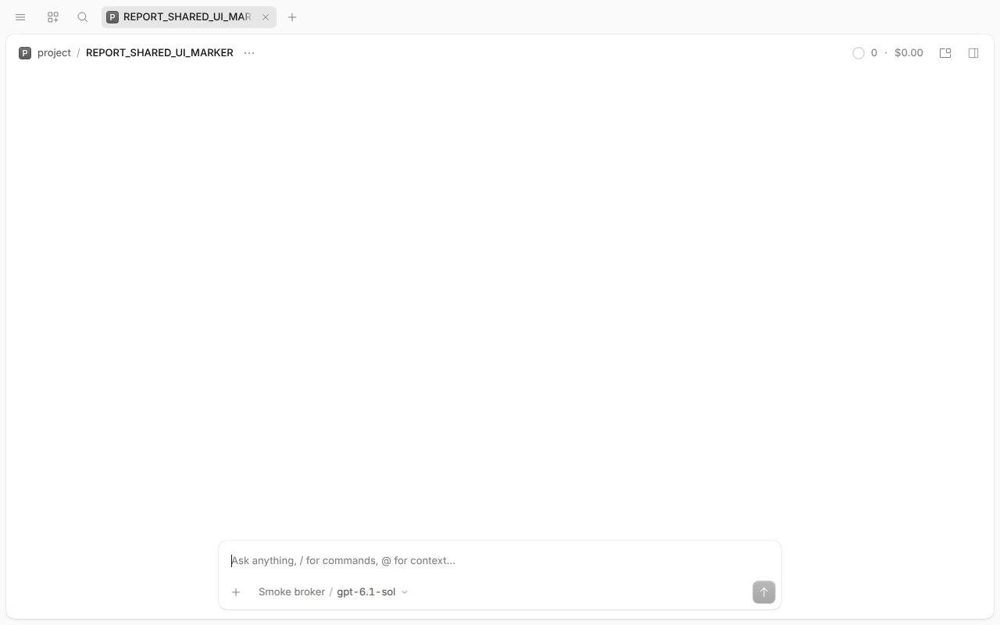
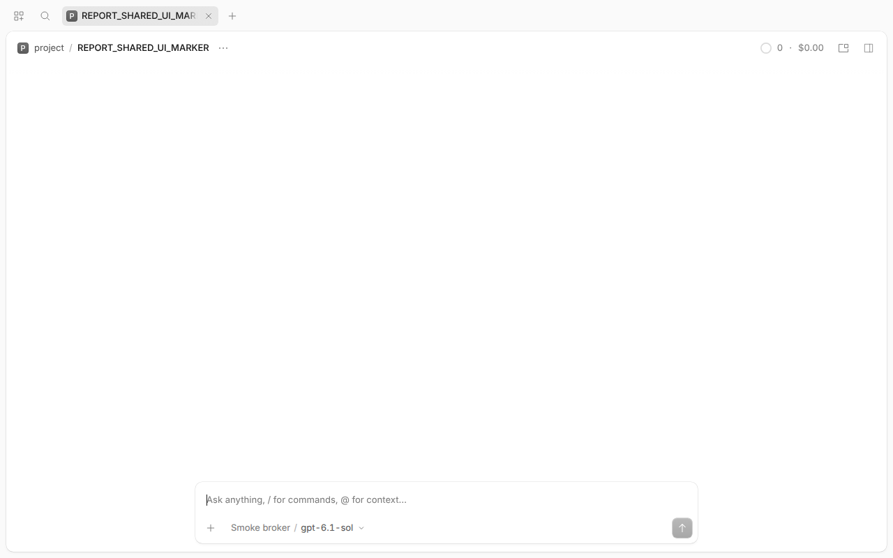

# Hoàn thiện demo còn thiếu — kết quả revision2

**Các hạng mục chức năng còn thiếu đã có bằng chứng native.** [Audit runtime revision02](../research/artifacts/NATIVE-COMPLETION-R2-REVIEW-20261111-02/validation.json) thêm side-effect counter cho subagent restart; [bảng nghiệm thu đề bài](../research/REQUIREMENTS_ACCEPTANCE.md). Đây là phần tiếp của [vòng1](NATIVE_RUNTIME_RESULTS.md), không ghi đè các raw/failure cũ. Scripted local Responses SSE, **0 request provider thật /0 key-content reads**, không mở lại benchmark48 hoặc tăng guard.

Pins giữ v1.19.5/v2.2.5. SDK published2.2.5; Desktop `.deb` official2.2.5 tải riêng, SHA256 `c827e714220de744c829fdea55540ed814b1372061e7a905fde0978f9f819de8`, chỉ extract dưới `.local/demo-desktop-2.2.5`, không install global. Native processes trong fresh OS/network namespace, HOME/XDG/DB/service/PTY riêng; không dùng display hoặc service người dùng. E-0135–E-0144 có commit/file/symbol/permalink ở [evidence.csv](../research/evidence.csv).

## 1. Recovery và resume-budget

| Case | Expected/actual và bằng chứng |
| --- | --- |
| BG07 shell crash | [Managed-service attempt04](artifacts/NATIVE-BG-SERVICE-RECOVERY-20261111-04/client-result.json) đổi PID sau SIGKILL đúng child thử nghiệm; native cancellation notice chứa shellID, không chạy lại shell. Đạt, E-0135/E-0136. Không suy OS process sống qua restart. |
| BG08 subagent restart | [Native child recovery](artifacts/NATIVE-SUBAGENT-RECOVERY-20261111-01/client-result.json): crash lúc child inference pending; PID mới, parent/child lineage không đổi, child inference được gọi lại, marker và completion về parent. [Counter case riêng](artifacts/NATIVE-SUBAGENT-SIDEEFFECT-RECOVERY-20261111-01/client-result.json): child shell hoàn tất append1marker trước crash; sau resume vẫn1marker, không duplicate ở case đã đo. Đạt, E-0137. Không suy exactly-once cho crash giữa external effect và commit. |
| BG09 budget exhaustion | [Raw11crashes](artifacts/NATIVE-RESUME-BUDGET-20261111-01/client-result.json) giữ controller status `error` do regex assertion sai. [Independent review](../research/artifacts/NATIVE-RESUME-BUDGET-REVIEW-20261111-01/validation.json) xác nhận exact native terminal `idle/outcome=failed`, message `Execution was interrupted repeatedly and will not be resumed automatically.`, không có request12. Read-only DB: `time_suspended=null`, `resume_attempts=0`, `idle_outcome=failed`. Đạt sau review, **không rerun hoặc mutate DB/raw**; E-0138. |

Root cause harness recovery cũ: registration được ghi trước application readiness; HTTP `/api/info`503 có thể là starting, không phải auth failure. Subscribe quá sớm kết thúc stream nhưng readiness promise cũ không reject. Attempt03 ghi503 rõ; attempt04 thêm bounded boot health check theo source + timeout/reject readiness rồi đạt. Không sửa product. `--stdio` graceful/crash cũ vẫn không có notice trong raw; kết quả managed-service không được ghi ngược thành stdio pass.

## 2. Permission/config v1/v2 và background v1

- [V1 API6turns](artifacts/NATIVE-V1-PERMISSION-API-20261111-01/v1-result.json): subscribe trước prompt; `permission.asked`→pending→reply`once/reject/always`; witness thực ghi/không ghi theo quyết định. Once hỏi lại, always cho command pattern liên quan mà không hỏi lại; command khác hỏi và reject không tạo witness. Đây là API approval interaction, không phải thao tác bàn phím permission UI. `always` trong `InstanceState`, không suy durable savedapproval qua server restart (E-0140).
- [V1 subagent](artifacts/NATIVE-V1-SUBAGENT-20261111-03/v1-result.json): parent tiếp tục trước child hoàn tất, child `parentID` đúng và completion marker về parent. **Cần `OPENCODE_EXPERIMENTAL_BACKGROUND_SUBAGENTS=true`**, chỉ bật trong sandbox; mặc định không bật thì attempt01 bị native error đúng thông báo (E-0139). Attempt02 fakeprovider đọc nhầm vị trí custom system; attempt03 sửa routing, không sửa product.
- [V1 permission object trên v2](artifacts/NATIVE-V1CONFIG-ON-V2-20261111-01/summary.json): bỏ native `permissions`, dùng legacy `permission` cùng `bash`; 5case allow/deny/overlapallow/overlapdeny/ask có witness đúng. Không suy mọi field legacy/plugin tương thích (E-0141).
- [Unmatched v2](artifacts/NATIVE-UNMATCHED-PERMISSION-20261111-02/client-result.json): test-only plugin bỏ base wildcard, kiểm effective agent không có rule khớp action riêng → ask, once không persist, reject settle hết pending (E-0144). Unrelated browser/skill deny vẫn có, nên assertion empty-array ở attempt01 sai; **không đổi tiêu chí fallback** khi sửa assertion về đúng “không matchingrule”. Không nhầm fallback với base default.

## 3. Native shared Desktop/Web/TUI

[Raw accepted UI05](artifacts/NATIVE-SHARED-UI-20261111-05/ui-result.json), [TUI result](artifacts/NATIVE-SHARED-UI-20261111-05/tui-result.json), [raw PTY](artifacts/NATIVE-SHARED-UI-20261111-05/tui-pty.ansi).

1. Start managed service riêng, health200 và ghi PID/URL; tạo session `REPORT_SHARED_UI_MARKER` qua API.
2. Chạy Desktop đóng gói2.2.5 trong headless Chromium; app tự discovery service từ cùng private XDG. Native route hiển thị đúng session ID/title. Đặt viewport chỉ trong headless test context, không tác động UI đang mở.
3. Renderer Chromium chuyển sang URL webapp do cùng service phục vụ, đúng session ID/title. Đây là **web frontend thật trong native Chromium engine**, không standalone browser binary và không Python HTTP giả UI.
4. TUI native trong PTY140×40 dùng default discovery, **không `--server`**, mở cùng session qua `--session`; rawANSI chứa title. Service PID cuối giống PID đầu; Desktop không thay service. E-0142/E-0143.

Ảnh chụp native1280×800, không ảnh dựng:





Ảnh UI02/04 chỉ1×1 do headless window size, giữ nguyên như failed visual acceptance; UI05 dùng CDP viewport có ảnh đúng. UI01 lỗi harness executable name (`ai.opencode`, không `opencode-desktop`) trước native process. UI03/04 là tiến độ từng phần, không thay bằng pass tổng. Không có screenshot terminal emulator; rawPTY là bằng chứng TUI. Desktop `--no-sandbox` chỉ trong OS namespace ngoài, **không phải kiểm security của Electron**. Telemetry attempt của app bị namespace chặn egress, không provider call.

## 4. Client/SDK error, timeout, interrupt

[Client failure matrix](artifacts/NATIVE-CLIENT-FAILURES-20261111-01/client-result.json), [SDK failure matrix](artifacts/NATIVE-SDK-FAILURES-20261111-01/sdk-result.json):

- Scripted providerHTTP400 có marker → native terminal failed, message giữ đúng; không gọi đó là provider outage thật.
- Chặn scripted inference; abort wait request sau50ms → Promise reject, execution vẫn chưa idle. **Request timeout không đồng nghĩa cancel execution.**
- Gọi `session.interrupt` native → idle không success, release fixture; SDK explicitclose trả về. Missingauth Client→401; embedded host không có network listener nên không áp giả HTTPauth.
- Subscriber disconnect/observer mới có từ vòng1; không suy replay/automatic reconnect của Client.

## 5. Tái lập, kiểm thử và giới hạn

- 73 Python demo +118 benchmark tests +3 Bun tests = **194 tests đạt**. Hai legacy reservation tests dùng IDs đã hiện diện trong CSV thật cần mock CSV view đúng phạm vi2test/temp state như receipt vòng1, không sửa sealedrunner hoặc registry. Tests chỉ gọi mock/local, không provider/key.
- [SDK tree snapshot](../research/artifacts/NATIVE-SDK-DEPENDENCIES-20261111-01/manifest.json): SHA25632.361files và22symlinks; không có lockfile do installer, không gọi snapshot là lock. Registry provenance và decoded statements giữ riêng, **chưa cryptographically verify**; workflow reports commit `958f965d35ed44d32b018fd55b02a5357a7748fd`, không phải source pin. Vì workflow có thể checkout khác, không claim exact package-build/source equivalence. Đây là giới hạn provenance chứ không phủ nhận runtime package2.2.5 đã kiểm.
- Đợt này hoàn tất case chức năng bổ sung, **không** chứng minh semantic memory của model, OSsecurity tương đương, mọi config/plugin migration hoặc exactly-once effects. Không cần gọi API thật mới để chứng minh những đường runtime này; benchmark thật48lượt giữ kết quả46success/2failure, mọi usage thiếu vẫnunknown.

## 6. Lệnh tái tạo

Chỉ dùng fresh artifact ID và môi trường đã chuẩn bị; không chạy các lệnh này để ghi đè artifact hiện có:

```sh
python3 -B demos/client_runtime.py --artifact-dir demos/artifacts/<fresh-id> --mode background-service-restart
python3 -B demos/client_runtime.py --artifact-dir demos/artifacts/<fresh-id> --mode subagent-service-restart
python3 -B demos/client_runtime.py --artifact-dir demos/artifacts/<fresh-id> --mode budget-service-restart
python3 -B demos/v1_runtime.py --artifact-dir demos/artifacts/<fresh-id> --mode permission
python3 -B demos/v1_runtime.py --artifact-dir demos/artifacts/<fresh-id> --mode subagent
python3 -B demos/ui_runtime.py --artifact-dir demos/artifacts/<fresh-id>
python3 -B demos/client_runtime.py --artifact-dir demos/artifacts/<fresh-id> --mode failure-matrix
python3 -B demos/sdk_runtime.py --artifact-dir demos/artifacts/<fresh-id> --mode failure-matrix
python3 -B demos/client_runtime.py --artifact-dir demos/artifacts/<fresh-id> --mode permission-unmatched
```

Runner snapshots/hash ở từng artifact; binary không thay. Các process con được dừng theo handle/PID do runner tạo; outer namespace cleanup, không `killall`, không xóa DB/session thật. Protocol [COMPLETION_SCOPE_R2.md](COMPLETION_SCOPE_R2.md); pin/config/fixture trong manifests. Budget acceptedraw là independent review chứ không sửa status gốc.
