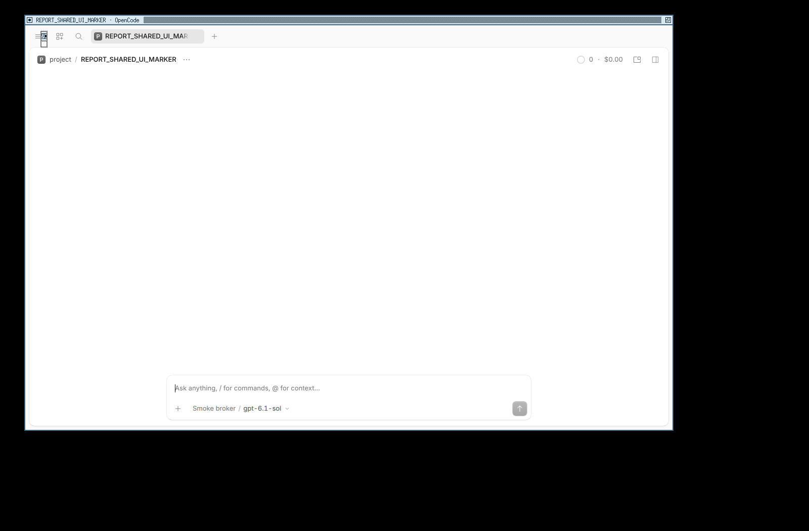
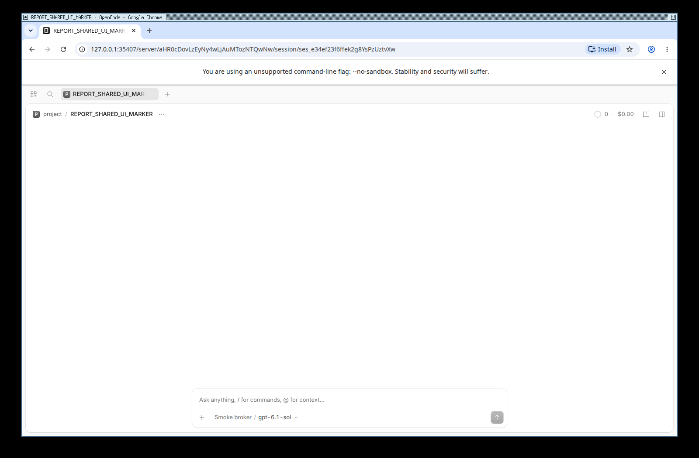
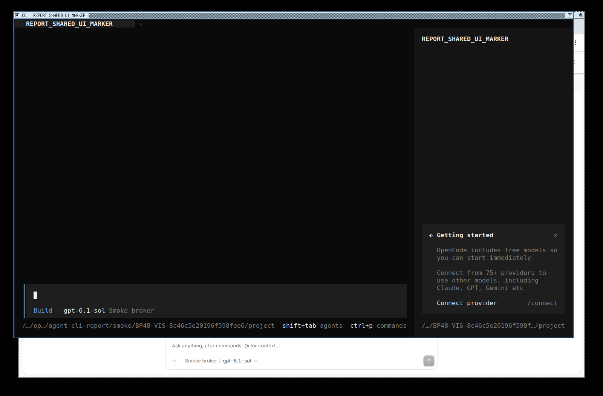

# Ảnh UI mới: Desktop / Chrome Web / TUI

**Đạt sau review ảnh và raw** trong [attempt07](artifacts/NATIVE-VISIBLE-UI-20261111-07/ui-visible-result.json), [validation](../research/artifacts/NATIVE-VISIBLE-UI-REVIEW-20261111-01/validation.json). Đây là lượt UI mới được người dùng duyệt, không phải đổi nhãn hai ảnh UI05 cũ.

| Đối chiếu cùng lượt | Giá trị |
| --- | --- |
| Session ID | `ses_e34ef23f6ffek2g8YsPzUztvXw` |
| Title | `REPORT_SHARED_UI_MARKER` |
| Service URL | `http://127.0.0.1:35407` |
| Service PID trước / sau Desktop / sau cả ba client | `12 / 12 / 12` trong namespace thử nghiệm |
| Desktop | Packaged OpenCode 2.2.5, `oc://renderer/index.html`, route sidecar chứa đúng session ID |
| Web | Google Chrome độc lập, HTTP route chứa cùng session ID; ảnh thấy toolbar và thanh địa chỉ thật |
| TUI | Native CLI 2.2.5, `--session` đúng ID, default discovery; raw ANSI có title |

## Ảnh gốc, không dựng khung hoặc thanh địa chỉ

Ảnh 1600 × 1050 do Pillow/XCB chụp root screen của Xvfb riêng; khung cửa sổ do twm vẽ thật, Chrome tự hiển thị toolbar, TUI là byte stream thật qua PTY/xterm. Không dùng image generation hoặc thêm chữ giả vào screenshot. Cảnh báo `--no-sandbox` của Chrome được giữ nguyên; OS namespace ngoài vẫn cách ly, không suy security equivalence từ demo.

[Raw result](artifacts/NATIVE-VISIBLE-UI-20261111-07/ui-visible-result.json), [TUI result](artifacts/NATIVE-VISIBLE-UI-20261111-07/tui-result.json), [raw ANSI](artifacts/NATIVE-VISIBLE-UI-20261111-07/tui-pty.ansi), [manifest/source snapshots](artifacts/NATIVE-VISIBLE-UI-20261111-07/manifest.json). Không ghép session/PID của lượt cũ vào ảnh mới. Raw controller status vẫn là `checks_passed_pending_review`; receipt review riêng xác nhận các checks và ảnh đạt, không sửa raw.

## Cách ly và dọn process

- HOME/XDG/config/DB/service/workspace mới; bwrap user/PID/network/IPC/UTS namespaces, D-Bus riêng. Không mount HOME thật, display socket hoặc credential của người dùng.
- Xvfb `:91` riêng; không hiển thị cửa sổ lên màn hình đang làm việc. Tiện ích Xvfb/twm/xterm/libutempter được tải qua HTTPS, kiểm SHA-256 rồi extract dưới `.local/ui-capture-tools-20261111`, không install hệ thống.
- Desktop/Chrome/TUI chỉ mở session; không gửi prompt, gọi provider hoặc chạy benchmark. Native egress bị network namespace chặn. Giá trị model trên UI là config hiển thị, không chứng minh đã gọi model.
- Dừng owned process handles và đợi exit; outer namespace supervisor đã biến mất. TUI exit 130 do dừng chủ động sau chụp, không phải lỗi giải task.
- 58 raw input hashes của phụ lục trước đó vẫn nguyên; không thay bảng benchmark, registry hoặc receipts cũ.

## Các lượt chưa đạt được giữ nguyên

| Attempt | Quan sát |
| --- | --- |
| 01–02 | Desktop trên display X11 mới bị CDP evaluate timeout/ảnh trống; chưa đủ visual acceptance |
| 03 | Sau thêm D-Bus riêng và password-store basic, Desktop render đúng; CDP Browser domain không có `getWindowForTarget`, controller dừng |
| 04 | Desktop chụp được; Chrome không khởi động do UNIX socket dưới TMPDIR quá dài |
| 05 | Checks qua cả ba client nhưng ảnh Desktop bị đen do thời điểm map window; không dùng làm bộ ảnh đạt |
| 06 | Helper raise cửa sổ gọi focus quá sớm, X11 BadMatch; giữ raw/error screenshot |
| 07 | Bỏ forced focus, map/raise owned window và chờ render; cả ba screenshot được xem trực tiếp, raw checks/PID/ID/cleanup đạt |

Các sửa đổi trên thuộc harness/environment thử, không sửa sản phẩm hoặc nới tiêu chí để gọi ảnh đen là pass. [Scope](UI_RECAPTURE_SCOPE.md); tái chạy bằng `python3 -B demos/ui_recapture.py --artifact-dir "demos/artifacts/NATIVE-VISIBLE-UI-$(date -u +%Y%m%dT%H%M%S%N)"` trong môi trường đã chuẩn bị, không tự thay bằng service/profile thật.
